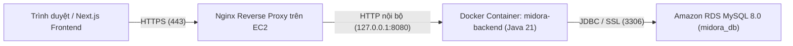

# Hướng Dẫn Deploy `midora-backend` Lên AWS (Phương Án A: EC2 + Docker + Nginx + RDS)

Tài liệu này được thiết kế để bạn **vừa thực hành từng bước, vừa hiểu bản chất từng thành phần** khi lần đầu triển khai Spring Boot + MySQL lên AWS.

---

## 1. Kiến trúc tổng quan & Giải thích khái niệm



### Tại sao cần từng thành phần?
1. **Amazon EC2 (Elastic Compute Cloud)**: Máy chủ ảo Linux (Ubuntu) chạy trên cloud AWS — đóng vai trò "máy tính luôn bật 24/7" để chạy backend của bạn.
2. **Security Group (Tường lửa ảo trên AWS)**: Quy định cổng (port) nào được phép đi vào/ra EC2 và RDS. Nguyên tắc vàng: **chỉ mở những port thực sự cần thiết**.
3. **Docker (`Dockerfile`)**: Đóng gói sẵn Java 21 + file `.jar` của `midora-backend` thành một container đồng nhất. Bạn không cần cài Java/Maven thủ công trên EC2, chạy trên máy nào cũng giống hệt nhau.
4. **Amazon RDS (MySQL 8.0)**: Dịch vụ database được AWS quản lý sẵn (tự backup, ổn định, tách biệt với server code). Khi backend khởi động, **Flyway** sẽ tự đọc `V1__init_schema.sql` để tạo toàn bộ bảng.
5. **Nginx Reverse Proxy**: Đứng trước container Spring Boot để nhận request từ internet qua cổng chuẩn `80` (HTTP) / `443` (HTTPS) rồi chuyển tiếp vào `127.0.0.1:8080`.
6. **SSL/HTTPS (Let's Encrypt + Certbot)**: Mã hóa đường truyền. **Bắt buộc** nếu frontend của bạn chạy trên `https://` (như Vercel), vì trình duyệt sẽ chặn `https://` gọi sang `http://`.

---

## 2. Bảng theo dõi tiến độ

- [x] **Bước 1**: Chuẩn bị code Backend (`HealthController`, `application-prod.properties`, `Dockerfile`, `.env.example`)
- [ ] **Bước 2**: Tạo Security Group & Database trên **Amazon RDS (MySQL 8.0)**
- [ ] **Bước 3**: Tạo **EC2 Ubuntu**, cấp quyền Security Group & cài Docker/Nginx/Swap
- [ ] **Bước 4**: Đưa source code lên EC2, cấu hình `.env` & chạy Docker container
- [ ] **Bước 5**: Cấu hình Nginx Reverse Proxy + SSL HTTPS
- [ ] **Bước 6**: Kết nối Frontend (`NEXT_PUBLIC_API_URL`) & Kiểm thử toàn bộ hệ thống

---

## 3. Chi tiết từng bước thực hành

### Bước 1: Chuẩn bị Backend (Đã tạo sẵn trong repo)
Các file đã được chuẩn bị cho `midora-backend`:
- `src/main/java/com/midora/common/controller/HealthController.java`: Mở endpoint `GET /api/v1/health` (không cần đăng nhập) để kiểm tra backend sống hay chưa.
- `src/main/java/com/midora/config/SecurityConfig.java`: Cho phép public `GET /health`.
- `src/main/resources/application-prod.properties`: Tắt log SQL (`show-sql=false`), bật `server.forward-headers-strategy=native` để Spring Boot hiểu đúng IP/HTTPS khi đi qua Nginx.
- `Dockerfile` & `.dockerignore`: Build multi-stage (Maven build `.jar` -> chạy trên Alpine JRE 21 siêu nhẹ), giới hạn RAM JVM `-XX:MaxRAMPercentage=75.0` để tránh tràn RAM trên EC2 nhỏ.
- `.env.example` & `.gitignore`: Mẫu biến môi trường và chặn commit nhầm file `.env`, `*.pem`.

> **Lưu ý**: Đừng quên `git add`, `git commit` và `git push` các file mới này lên GitHub để bước sau clone về EC2.

---

### Bước 2: Tạo Database trên Amazon RDS (MySQL 8.0)

1. Đăng nhập **AWS Console**, chọn Region gần Việt Nam nhất (ví dụ **Singapore — `ap-southeast-1`**). *Tất cả dịch vụ EC2 và RDS phải nằm cùng 1 Region.*
2. **Tạo Security Group cho RDS**:
   - Vào **VPC** -> **Security Groups** -> **Create security group**.
   - Name: `midora-rds-sg`, giữ nguyên VPC mặc định.
   - Tạm thời để trống Inbound rules (ta sẽ mở port `3306` cho EC2 ở Bước 3).
3. **Tạo RDS MySQL**:
   - Vào **RDS** -> **Databases** -> **Create database**.
   - Creation method: **Standard create**.
   - Engine type: **MySQL** (chọn phiên bản **8.0.x**).
   - Templates: **Free tier** *(nếu tài khoản còn Free Tier; hoặc chọn Dev/Test với `db.t3.micro`/`db.t4g.micro`)*.
   - Settings:
     - DB instance identifier: `midora-mysql`
     - Master username: `admin` (hoặc tên bạn muốn)
     - Master password: đặt mật khẩu mạnh (lưu lại cẩn thận, **tránh ký tự đặc biệt dễ lỗi URL** như `@`, `/`, `?`, `#`).
   - Connectivity:
     - Public access: **No** (bảo mật tốt nhất vì chỉ EC2 trong cùng VPC được kết nối).
     - VPC security group: Chọn **Choose existing** -> chọn `midora-rds-sg`.
   - Additional configuration:
     - **Initial database name**: `midora_db` *(rất quan trọng — khớp với JDBC URL mặc định)*.
   - Nhấn **Create database** (đợi 5–10 phút đến khi Status là **Available**).
4. Vào chi tiết `midora-mysql` -> tab **Connectivity & security** -> copy **Endpoint** (dạng `midora-mysql.xxxx.ap-southeast-1.rds.amazonaws.com`).

---

### Bước 3: Tạo máy chủ EC2 Ubuntu & Mở tường lửa

1. **Tạo Security Group cho EC2** (hoặc tạo ngay lúc Launch Instance):
   - Vào **EC2** -> **Instances** -> **Launch instances**.
   - Name: `midora-backend-ec2`.
   - OS / AMI: **Ubuntu Server 24.04 LTS** (64-bit x86).
   - Instance type: `t3.micro` hoặc `t2.micro` (Free Tier — 1GB RAM).
   - Key pair: Nhấn **Create new key pair** -> tên `midora-ec2-key`, định dạng `.pem` -> tải về máy và cất kỹ (không chia sẻ file này).
   - Network settings -> Create security group (`midora-ec2-sg`), bật:
     - **SSH (22)**: Source = **My IP** (chỉ IP nhà bạn được SSH).
     - **HTTP (80)**: Source = **Anywhere (`0.0.0.0/0`)**.
     - **HTTPS (443)**: Source = **Anywhere (`0.0.0.0/0`)**.
     - *(Tạm thời trong lúc chưa gắn tên miền/Nginx, có thể mở thêm Custom TCP `8080` để test trực tiếp, sau đó nhớ xóa rule `8080` này đi!)*
   - Storage: `20 GiB gp3` (Free Tier cho phép tối đa 30 GiB).
   - Nhấn **Launch instance**.

2. **Nối quyền Security Group để EC2 gọi được RDS**:
   - Quay lại **VPC -> Security Groups -> `midora-rds-sg`** -> tab **Inbound rules** -> **Edit inbound rules** -> **Add rule**:
     - Type: **MYSQL/Aurora** (Port `3306`)
     - Source: **Custom** -> chọn Security Group `midora-ec2-sg`.
   - Save rules. *(Nhờ vậy chỉ duy nhất EC2 của bạn chạm được vào database, hacker bên ngoài không thể quét port 3306).*

3. **Gắn Elastic IP (khuyên dùng)**:
   - Mặc định mỗi lần Stop/Start EC2 sẽ bị đổi IP Public.
   - Vào **EC2 -> Elastic IPs -> Allocate Elastic IP address -> Associate** vào `midora-backend-ec2` để IP cố định vĩnh viễn (miễn phí khi đang gắn vào EC2 đang chạy).

4. **SSH vào EC2 & Cài đặt môi trường**:
   Từ PowerShell trên Windows (thay đường dẫn file `.pem` và IP của bạn):
   ```powershell
   ssh -i "C:\path\to\midora-ec2-key.pem" ubuntu@<EC2_PUBLIC_IP>
   ```

   Sau khi vào trong terminal Ubuntu của EC2, chạy lần lượt:
   ```bash
   # 1. Cập nhật hệ thống
   sudo apt update && sudo apt upgrade -y

   # 2. Tạo Swap 2GB (RẤT QUAN TRỌNG cho máy 1GB RAM để Docker build không bị treo)
   sudo fallocate -l 2G /swapfile
   sudo chmod 600 /swapfile
   sudo mkswap /swapfile
   sudo swapon /swapfile
   echo '/swapfile none swap sw 0 0' | sudo tee -a /etc/fstab

   # 3. Cài Docker
   curl -fsSL https://get.docker.com -o get-docker.sh
   sudo sh get-docker.sh
   sudo usermod -aG docker ubuntu
   newgrp docker

   # 4. Cài Nginx & Certbot (cho bước HTTPS)
   sudo apt install -y nginx certbot python3-certbot-nginx git
   ```

---

### Bước 4: Build & Chạy Backend Container trên EC2

1. **Clone repo về EC2** (nếu repo private, dùng GitHub Personal Access Token hoặc SSH deploy key):
   ```bash
   git clone <URL_REPO_CUA_BAN> midora
   cd midora/midora-backend
   ```

2. **Tạo file `.env` từ `.env.example`**:
   ```bash
   cp .env.example .env
   openssl rand -hex 32   # Copy chuỗi ngẫu nhiên này làm JWT_SECRET
   nano .env
   ```
   Điền đầy đủ giá trị thực tế:
   ```env
   SPRING_PROFILES_ACTIVE=prod
   SPRING_DATASOURCE_URL=jdbc:mysql://<RDS_ENDPOINT>:3306/midora_db?useSSL=true&serverTimezone=UTC
   SPRING_DATASOURCE_USERNAME=admin
   SPRING_DATASOURCE_PASSWORD=<MAT_KHAU_RDS>
   JWT_SECRET=<CHUOI_64_KY_TU_VUA_TAO>
   CORS_ALLOWED_ORIGINS=https://<DOMAIN_FRONTEND>,http://localhost:3000
   ```
   *(Lưu trong `nano`: `Ctrl + O` -> `Enter` -> `Ctrl + X`)*

3. **Build Docker Image & Chạy Container**:
   ```bash
   docker build -t midora-backend:latest .

   docker run -d \
     --name midora-backend \
     --restart unless-stopped \
     --env-file .env \
     -p 127.0.0.1:8080:8080 \
     midora-backend:latest
   ```
   *(Lưu ý `-p 127.0.0.1:8080:8080`: chỉ lắng nghe nội bộ để Nginx gọi vào, không lộ port 8080 ra internet).*

4. **Xem log kiểm tra Flyway & Spring Boot**:
   ```bash
   docker logs -f midora-backend
   ```
   Nếu thấy `Started MidoraBackendApplication in ... seconds` và không có lỗi DB, thử test ngay trên EC2:
   ```bash
   curl http://127.0.0.1:8080/api/v1/health
   ```
   Kết quả mong đợi:
   ```json
   {"success":true,"message":"OK","data":{"service":"midora-backend","status":"UP"},...}
   ```

---

### Bước 5: Cấu hình Nginx Reverse Proxy & HTTPS

> **Nếu bạn đã có tên miền** (ví dụ `api.midora.vn`): vào trang quản lý DNS (Cloudflare, Namecheap, Route53...) tạo **A Record** trỏ `api` -> `<EC2_ELASTIC_IP>`.

1. Tạo file cấu hình Nginx:
   ```bash
   sudo nano /etc/nginx/sites-available/midora-backend
   ```
   Dán nội dung sau (thay `api.yourdomain.com` bằng tên miền thật của bạn, hoặc dùng `_` tạm thời nếu chưa có tên miền):
   ```nginx
   server {
       listen 80;
       server_name api.yourdomain.com;

       client_max_body_size 20M;

       location / {
           proxy_pass http://127.0.0.1:8080;
           proxy_http_version 1.1;
           proxy_set_header Host $host;
           proxy_set_header X-Real-IP $remote_addr;
           proxy_set_header X-Forwarded-For $proxy_add_x_forwarded_for;
           proxy_set_header X-Forwarded-Proto $scheme;
       }
   }
   ```

2. Kích hoạt cấu hình & khởi động lại Nginx:
   ```bash
   sudo ln -s /etc/nginx/sites-available/midora-backend /etc/nginx/sites-enabled/
   sudo rm -f /etc/nginx/sites-enabled/default
   sudo nginx -t
   sudo systemctl reload nginx
   ```

3. **Cài chứng chỉ SSL miễn phí (HTTPS)** *(khi đã trỏ tên miền về EC2)*:
   ```bash
   sudo certbot --nginx -d api.yourdomain.com
   ```
   Chọn đồng ý điều khoản và chọn **Redirect HTTP to HTTPS**. Certbot sẽ tự gia hạn chứng chỉ định kỳ.

4. Kiểm tra từ máy tính cá nhân của bạn:
   ```bash
   curl https://api.yourdomain.com/api/v1/health
   ```

---

### Bước 6: Kết nối Frontend & Quy trình cập nhật code về sau

1. **Cấu hình Frontend (`midora-frontend`)**:
   - Đặt biến môi trường trên nền tảng deploy frontend (hoặc `.env.production`):
     ```env
     NEXT_PUBLIC_API_URL=https://api.yourdomain.com/api/v1
     ```
   - Đảm bảo URL frontend khớp chính xác trong `CORS_ALLOWED_ORIGINS` của file `.env` trên EC2.

2. **Khi bạn sửa code backend và muốn deploy lại lên EC2**:
   ```bash
   cd ~/midora
   git pull origin main
   cd midora-backend
   docker build -t midora-backend:latest .
   docker stop midora-backend && docker rm midora-backend
   docker run -d --name midora-backend --restart unless-stopped --env-file .env -p 127.0.0.1:8080:8080 midora-backend:latest
   docker image prune -f
   ```

---

## 4. Xử lý các lỗi thường gặp (Troubleshooting)

| Triệu chứng | Nguyên nhân phổ biến | Cách kiểm tra & khắc phục |
| :--- | :--- | :--- |
| Backend không khởi động, lỗi `Communications link failure` | EC2 không kết nối được RDS | Kiểm tra Inbound Rule port `3306` trên `midora-rds-sg` đã trỏ về `midora-ec2-sg` chưa; kiểm tra `SPRING_DATASOURCE_URL` và tên DB `midora_db`. |
| `502 Bad Gateway` từ Nginx | Container chưa chạy hoặc đang crash | Chạy `docker ps` và `docker logs midora-backend` để xem lỗi Java. |
| Lỗi `CORS` trên trình duyệt | `CORS_ALLOWED_ORIGINS` thiếu domain hoặc dư dấu `/` cuối | Đảm bảo đúng dạng `https://app.midora.vn` (không có `/` ở cuối) rồi restart container. |
| EC2 bị treo khi chạy `docker build` | Máy `t2.micro`/`t3.micro` hết RAM 1GB | Chắc chắn đã tạo **Swap 2GB** ở Bước 3, hoặc build image ở máy local/GitHub Actions rồi push lên DockerHub/ECR. |
| `FlywayValidateException` | Sửa file migration cũ đã từng chạy trên DB | Luôn tạo file mới `V2__...sql`, không sửa file `V1__init_schema.sql` đã áp dụng lên RDS. |

