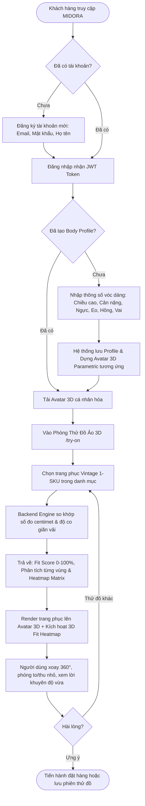
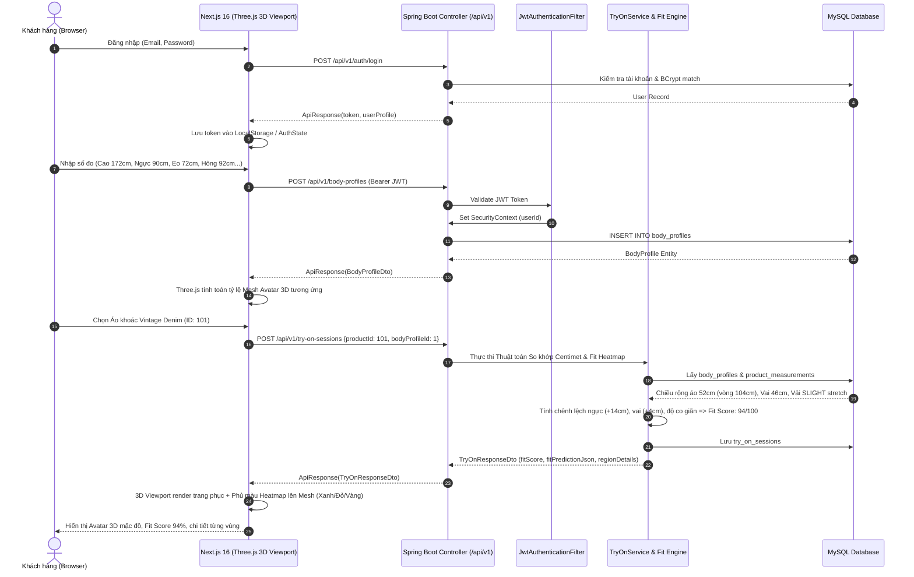

# KẾ HOẠCH TRIỂN KHAI CHI TIẾT (IMPLEMENTATION PLAN)
## MVP MIDORA: XÁC THỰC, TẠO AVATAR 3D & THỬ ĐỒ ẢO THEO SỐ ĐO CƠ THỂ

---

- **Dự án**: MIDORA – B2B2C 3D Virtual Try-On Marketplace for Secondhand & Vintage Fashion
- **Phiên bản tài liệu**: 1.0 (MVP Scope)
- **Tác giả**: Antigravity Pair Programmer
- **Trạng thái**: Chờ phê duyệt (Pending Approval)

---

## 1. TỔNG QUAN & MỤC TIÊU MVP (GOALS & SCOPE)

### 1.1. Bối cảnh & Mục tiêu
MIDORA giải quyết bài toán lớn nhất trong thương mại điện tử thời trang secondhand/vintage: **mỗi món đồ là một bản thể độc nhất (1-SKU) với số đo centimet riêng biệt, không theo bảng size chuẩn S/M/L**. Khách hàng e ngại mua sắm vì không biết đồ có vừa với vóc dáng của mình hay không.

Mục tiêu trọng tâm của giai đoạn MVP này là xây dựng hoàn chỉnh **Trải nghiệm Thử đồ ảo 3D Cá nhân hóa (Personalized 3D Virtual Try-On)**, bao gồm:
1. **Xác thực người dùng (Authentication & Authorization)**: Đăng ký, đăng nhập tài khoản bằng JWT Token bảo mật, phân quyền (`ROLE_CUSTOMER`, `ROLE_STORE_OWNER`, `ROLE_ADMIN`).
2. **Hồ sơ số đo & Dựng Avatar 3D (Body Profile & 3D Avatar Creation)**: Người dùng nhập các số đo cơ thể thực tế (chiều cao, cân nặng, ngực, eo, hông, rộng vai...). Hệ thống tự động dựng một **Avatar 3D hình người (Humanoid 3D Parametric Avatar)** có tỷ lệ cơ thể biến đổi tương ứng trong không gian 3 chiều.
3. **Phòng Thử đồ ảo 3D & Bản đồ nhiệt vừa vặn (3D Virtual Try-On & Fit Heatmap)**:
   - Thử các trang phục vintage độc bản lên Avatar 3D của chính mình.
   - Thuật toán Centimeter-Level Fit Matching tính toán độ ôm/chênh lệch từng vòng cơ thể so với kích thước áo/quần và hệ số co giãn vải (`fabric_stretch`).
   - Xuất ra điểm số vừa vặn định lượng **Fit Score (0 – 100%)** và **Bản đồ nhiệt Fit Heatmap** (Xanh lá: vừa vặn hoàn hảo, Đỏ/Cam: chật, Xanh dương: rộng) trực quan hóa 360 độ trên mô hình 3D.

---

## 2. USER JOURNEY & FLOWCHART



---

## 3. KIẾN TRÚC HỆ THỐNG & CÔNG NGHỆ (TECH STACK ARCHITECTURE)

### 3.1. Frontend Architecture (`midora-frontend/`)
- **Framework**: Next.js 16.4.6 (App Router), React 19.3.0, TypeScript 5.
- **Styling**: Tailwind CSS 4.3.3, Lucide React (Icons).
- **3D Engine**: **Three.js** (`three`, `@types/three`).
  - *Lý do lựa chọn Three.js thuần qua React Canvas Lifecycle*: Hoàn toàn tương thích 100% với React 19 (tránh xung đột peer-dependencies của Fiber/Drei), hiệu năng cao, kiểm soát linh hoạt hình học tham số (parametric humanoid geometry) và shader/material tinting cho bản đồ nhiệt Fit Heatmap.
- **State & API Communication**: Custom Hooks (`useAuth`, `useBodyProfile`, `useTryOn`) kết hợp `apiClient` tập trung gọi REST API `/api/v1`.

### 3.2. Backend Architecture (`midora-backend/`)
- **Framework**: Spring Boot 4.1.2, Java 21 LTS.
- **Persistence & Migration**: Spring Data JPA (Hibernate `ddl-auto=validate`), MySQL 8.x, **Flyway Migration** (`spring-boot-starter-flyway`, `flyway-mysql`), `spring.jpa.open-in-view=false`.
- **Security**: Spring Security + JWT (`jjwt-api`, `jjwt-impl`, `jjwt-jackson` version 0.12.6), BCrypt Password Encoder.
- **Validation**: Jakarta Validation (`@Valid`, `@NotNull`, `@Min`, `@Max`...).
- **API Standard**: Base path `/api/v1`, standardized envelopes `ApiResponse<T>`, Global Exception Handler trả HTTP codes chuẩn (400, 401, 403, 404, 409).



---

## 4. CHI TIẾT THIẾT KẾ DATABASE & DTO (DATA CONTRACT)

Quản lý phiên bản schema qua **Flyway Migration** (`src/main/resources/db/migration/V1__init_schema.sql`):

### 4.1. Bảng Dữ liệu sử dụng trong MVP
1. `users`: Tài khoản khách hàng (`id`, `email`, `password_hash`, `full_name`, `phone`, `role`).
2. `body_profiles`: Số đo vóc dáng (`height_cm`, `weight_kg`, `chest_cm`, `waist_cm`, `hips_cm`, `shoulder_width_cm`, `avatar_customization_params`, `is_default`).
3. `stores`: Thông tin cửa hàng vintage (`store_name`, `slug`, `bio`, `owner_id`).
4. `categories`: Danh mục quần áo (`name`, `slug`).
5. `products`: Sản phẩm vintage độc bản 1-SKU (`store_id`, `title`, `slug`, `price`, `condition_grade`, `status`, `is_unique`, `version`).
6. `product_images`: Hình ảnh sản phẩm (`image_url`, `is_primary`, `display_order`).
7. `product_measurements`: Thông số centimet chi tiết của trang phục (`chest_width_cm`, `shoulder_width_cm`, `sleeve_length_cm`, `shirt_length_cm`, `waist_width_cm`, `hip_width_cm`, `pant_length_cm`, `fabric_stretch`, `notes`).
8. `try_on_sessions`: Kết quả phiên thử đồ (`user_id`, `product_id`, `body_profile_id`, `fit_score`, `fit_prediction_json`, `result_image_url`, `status`).

### 4.2. Danh sách REST Endpoints Backend

| Phương thức | Endpoint | Yêu cầu Auth | Chức năng |
| :--- | :--- | :--- | :--- |
| `POST` | `/api/v1/auth/register` | Public | Đăng ký tài khoản người dùng mới |
| `POST` | `/api/v1/auth/login` | Public | Đăng nhập tài khoản & nhận JWT token |
| `GET` | `/api/v1/auth/me` | Bearer JWT | Lấy thông tin tài khoản hiện tại |
| `GET` | `/api/v1/body-profiles` | Bearer JWT | Lấy danh sách hồ sơ số đo của người dùng |
| `GET` | `/api/v1/body-profiles/default` | Bearer JWT | Lấy hồ sơ số đo mặc định |
| `POST` | `/api/v1/body-profiles` | Bearer JWT | Tạo mới hồ sơ số đo & avatar params |
| `PUT` | `/api/v1/body-profiles/{id}` | Bearer JWT | Cập nhật số đo hồ sơ |
| `GET` | `/api/v1/products` | Public | Danh sách sản phẩm vintage kèm số đo |
| `GET` | `/api/v1/products/{id}` | Public | Chi tiết sản phẩm & thông số `product_measurements` |
| `POST` | `/api/v1/try-on-sessions` | Bearer JWT | Khởi tạo phiên thử đồ 3D, chạy thuật toán tính Fit Score |
| `GET` | `/api/v1/try-on-sessions/history` | Bearer JWT | Lịch sử các lần thử đồ của người dùng |

---

## 5. THUẬT TOÁN ĐỊNH LƯỢNG 3D FIT SCORE ENGINE (BACKEND)

### 5.1. Nguyên lý So khớp Centimet
Thời trang vintage phẳng (flat garment) có số đo bề ngang (ví dụ `chest_width_cm`), khi quy đổi chu vi tương đối:
$$\text{Garment Circumference} \approx \text{Width} \times 2$$

Hệ số co giãn vải (`FabricStretch`):
- `NONE`: Vải thô không co giãn (Denim 100% cotton, da thật, dạ tweed, linen). Yêu cầu khoảng cử động (Ease Allowance) tối thiểu $+4\text{cm} \to +8\text{cm}$ để mặc vừa.
- `SLIGHT`: Co giãn nhẹ (Cotton pha 2-3% spandex, len dệt). Khoảng cử động $+2\text{cm} \to +5\text{cm}$.
- `STRETCHY`: Co giãn cao (Thun gân, len đan đàn hồi). Có thể ôm sát từ $-2\text{cm} \to +2\text{cm}$.

### 5.2. Công thức Đánh giá Từng Vùng (Region Fit Delta)
Đối với mỗi vùng cơ thể (Ngực, Eo, Vai, Hông):
$$\Delta = \text{Garment Metric} - \text{Body Metric}$$

Phân loại trạng thái (`FitStatus`):
- `TIGHT` (Bó chật): $\Delta < \text{Ease}_{\min}$ $\rightarrow$ Bản đồ nhiệt hiển thị **Đỏ / Cam** ($\Delta < 0$ là quá chật).
- `PERFECT` (Vừa vặn lý tưởng): $\text{Ease}_{\min} \le \Delta \le \text{Ease}_{\max}$ $\rightarrow$ Bản đồ nhiệt hiển thị **Xanh lá Emerald**.
- `LOOSE` (Rộng / Thoải mái): $\text{Ease}_{\max} < \Delta \le \text{Ease}_{\max} + 6\text{cm}$ $\rightarrow$ Bản đồ nhiệt hiển thị **Xanh biển nhạt**.
- `OVERSIZED` (Rất rộng): $\Delta > \text{Ease}_{\max} + 6\text{cm}$ $\rightarrow$ Bản đồ nhiệt hiển thị **Xanh dương đậm**.

### 5.3. Trọng số Tổng thể (Weighted Fit Score 0–100)
Tùy theo loại trang phục (Áo trên / Quần dưới):
- **Áo (Tops / Jackets)**: Trọng số Ngực (45%), Vai (35%), Eo (20%).
- **Quần (Pants / Bottoms)**: Trọng số Eo (50%), Hông (35%), Chiều dài quần (15%).

Dữ liệu trả về Frontend theo định dạng `fit_prediction_json`:
```json
{
  "fitScore": 92.5,
  "summary": "Áo khoác vừa vặn lý tưởng ở vai và ngực, dáng suông thoải mái.",
  "regions": {
    "chest": { "status": "PERFECT", "deltaCm": 5.0, "color": "#10B981", "label": "Vừa vặn (+5cm)" },
    "shoulder": { "status": "PERFECT", "deltaCm": 2.0, "color": "#10B981", "label": "Chuẩn vai (+2cm)" },
    "waist": { "status": "LOOSE", "deltaCm": 7.0, "color": "#3B82F6", "label": "Thoải mái (+7cm)" }
  }
}
```

---

## 6. THIẾT KẾ FRONTEND 3D AVATAR & TRY-ON VIEWPORT

### 6.1. Kiến trúc Three.js Parametric Mannequin
Để đảm bảo avatar phản ánh trung thực kích thước người dùng mà không cần chờ tải file 3D nặng hàng chục MB:
1. **Parametric Mannequin Mesh**:
   - Sử dụng mô hình hình học Three.js đa phần (Hierarchical Composite Mesh): Đầu (Head), Cổ (Neck), Thân trên/Ngực (Chest/Torso), Bụng/Eo (Waist/Abdomen), Hông (Pelvis), Cánh tay (Arms), Chân (Legs).
   - Tỷ lệ kích thước của các khối mesh (Head, Torso, Hips, Limbs) được liên kết động với các thông số từ `body_profiles`:
     - Tỷ lệ chiều cao $\rightarrow$ Tọa độ $Y$ và chiều dài chân/thân.
     - Tỷ lệ ngực (`chest_cm`) $\rightarrow$ Bán kính/độ dày trục $X, Z$ của khối Torso.
     - Tỷ lệ eo (`waist_cm`) $\rightarrow$ Độ co trục $X, Z$ vùng thắt lưng.
     - Tỷ lệ vai (`shoulder_width_cm`) $\rightarrow$ Khoảng cách 2 khớp vai.
     - Tỷ lệ hông (`hips_cm`) $\rightarrow$ Độ rộng khối chậu Pelvis.
2. **Dynamic Garment Layer**:
   - Mesh trang phục tương ứng (Áo khoác, sơ mi, quần) được tạo hình phủ bên ngoài lớp cơ thể của avatar với độ offset tự nhiên.
3. **Fit Heatmap Shading Material**:
   - Khi bật chế độ Heatmap (`toggleHeatmap = true`), chất liệu vật liệu (MeshStandardMaterial) tại từng vùng cơ thể/trang phục đổi màu theo mảng màu trả về từ `fit_prediction_json` (`#10B981` cho vùng chuẩn, `#EF4444` cho vùng chật, `#3B82F6` cho vùng rộng).
4. **Controls & Lighting**:
   - Ánh sáng studio: 1 Key Light, 1 Fill Light, 1 Rim Light giúp hiển thị form dáng sắc nét.
   - Xoay 360° tự do quanh trục thẳng đứng, giới hạn góc ngửa/cúi (Polar Angle) để tạo góc nhìn chuẩn mannequin thời trang.
   - Nút xoay nhanh: Mặt trước (Front), Mặt nghiêng (Side 45°), Mặt bên (Profile 90°), Mặt sau (Back).

### 6.2. Giao diện Phòng Thử đồ 3D (`/try-on`)
Cấu trúc 3 cột cân đối chuẩn phong cách Modern Editorial sang trọng của MIDORA:
- **Cột Trái (Catalog Selector)**: Danh sách sản phẩm vintage kèm tag 1-SKU, ảnh chụp, giá, và bảng số đo centimet gốc.
- **Cột Giữa (3D Virtual Fitting Room)**: Viewport 3D tương tác toàn màn hình, nút xoay các góc, nút chuyển đổi chế độ xem (Chế độ Thực tế / Chế độ Heatmap), thanh trượt điều chỉnh nhanh thông số người.
- **Cột Phải (Fit Intelligence Card)**:
  - Đồng hồ hiển thị **Fit Score** (0–100%).
  - Radar chart / Thanh đo chi tiết 4 vùng trọng yếu (Vai, Ngực, Eo, Hông).
  - Khuyến nghị mua hàng thông minh: "Khuyên bạn: Vừa vặn thoải mái, dáng đẹp".

---

## 7. KẾ HOẠCH THỰC HIỆN TỪNG BƯỚC (5 PHASES)

### Phase 1: Bổ sung Dependencies & Thiết lập Core Backend Security
1. Cập nhật `pom.xml`: Thêm thư viện `jjwt-api:0.12.6`, `jjwt-impl:0.12.6`, `jjwt-jackson:0.12.6`.
2. Tạo các gói dùng chung trong `com.midora.common`: `ApiResponse<T>`, `ErrorCode`, `BusinessException`, `GlobalExceptionHandler`.
3. Xây dựng tầng Security trong `com.midora.security`: `JwtTokenProvider`, `JwtAuthenticationFilter`, `MidoraUserPrincipal`, cấu hình `SecurityConfig` (mở public cho auth & catalog, bảo vệ endpoint cá nhân).
4. Xây dựng module User & Auth: `User` entity, `UserRepository`, `AuthService`, `AuthController` (`/api/v1/auth/register`, `/api/v1/auth/login`, `/api/v1/auth/me`).

### Phase 2: Backend Body Profile & Vintage Product Catalog
1. Entity & Repository:
   - `BodyProfile` entity (`user_id`, `height_cm`, `weight_kg`, `chest_cm`, `waist_cm`, `hips_cm`, `shoulder_width_cm`, `avatar_customization_params`).
   - `Product`, `ProductMeasurement`, `ProductImage`, `Store`, `Category` entities khớp chặt chẽ với Flyway schema `V1__init_schema.sql` (được kiểm tra bởi `ddl-auto=validate`).
2. Service & Controller:
   - `BodyProfileService` & `BodyProfileController`: CRUD hồ sơ số đo theo người dùng đăng nhập.
   - `ProductService` & `ProductController`: Tìm kiếm & xem chi tiết sản phẩm vintage kèm số đo phẳng.
3. Seeding Data (`V2__seed_mvp_data.sql` / `DataInitializer`): Tự động nạp sẵn tài khoản test, store vintage mẫu và 5 sản phẩm vintage thực tế (có số đo centimet chuẩn xác và ảnh mẫu).

### Phase 3: Backend Fit Score Engine & Try-On Session
1. Xây dựng thuật toán so khớp kích thước `FitCalculationEngine`:
   - Tính toán chu vi, độ chênh lệch delta, kết hợp hệ số co giãn `fabric_stretch`.
   - Tính `fit_score` và mảng JSON `fit_prediction_json`.
2. Entity & Repository: `TryOnSession` entity, `TryOnSessionRepository`.
3. Service & Controller: `TryOnService` & `TryOnController` (`POST /api/v1/try-on-sessions`).

### Phase 4: Frontend Thư viện 3D, Auth & Quản lý Avatar
1. Cài đặt thư viện: `npm install three` và `npm install -D @types/three`.
2. Xây dựng hạ tầng API Client & Auth Context:
   - `src/lib/apiClient.ts`: Tự động gán Bearer Token, chuẩn hóa phản hồi `ApiResponse<T>`.
   - `src/features/auth/`: `useAuth` hook, modal đăng nhập/đăng ký `AuthModal.tsx`.
3. Xây dựng Module Body Profile & Avatar 3D:
   - `src/features/avatar/components/BodyMetricsModal.tsx`: Form nhập số đo centimet trực quan có thước đo minh họa.
   - `src/features/avatar/components/Mannequin3D.ts`: Module tính toán hình học tỷ lệ cơ thể Three.js.
   - `src/features/avatar/components/AvatarViewer.tsx`: Canvas 3D tương tác xoay 360°, zoom, đổi góc nhìn.

### Phase 5: Hoàn thiện Phòng Thử đồ 3D (`/try-on`) & Kiểm thử
1. Xây dựng `src/features/try-on/`:
   - `TryOnViewport.tsx`: Hiển thị đồng thời Avatar 3D + Trang phục + Bản đồ nhiệt Heatmap.
   - `FitHeatmapLegend.tsx`: Bảng chú giải màu sắc bản đồ nhiệt.
   - `FitAnalysisCard.tsx`: Thẻ đánh giá Fit Score và chi tiết các vùng cơ thể.
2. Xây dựng trang `src/app/try-on/page.tsx` tích hợp đồng bộ các thành phần trên.
3. Cập nhật `Navbar.tsx` và `Hero.tsx` thêm nút chuyển nhanh vào **"Phòng thử đồ 3D"**.
4. Chạy kiểm tra cú pháp và build: `npm run lint` ở frontend và `./mvnw test-compile` ở backend.

---

## 8. KẾ HOẠCH XÁC MINH & KIỂM THỬ (VERIFICATION PLAN)

### 8.1. Kiểm tra Tự động (Automated Compilation & Lint Checks)
- **Backend**:
  ```bash
  cd e:\Github\Midora\midora-backend
  .\mvnw test-compile
  ```
  *Mục tiêu*: Đảm bảo toàn bộ mã Java 21, JPA Entities, Spring Security, JWT và DTOs biên dịch thành công 100% không có lỗi cú pháp hoặc annotation processor.
- **Frontend**:
  ```bash
  cd e:\Github\Midora\midora-frontend
  npm run lint
  ```
  *Mục tiêu*: Đảm bảo toàn bộ mã TypeScript, React 19 hooks, Three.js canvas components sạch lỗi ESLint và Type checking.

### 8.2. Kịch bản Kiểm thử Thủ công (Manual User Testing Scenarios)
1. **Kịch bản 1: Đăng ký & Đăng nhập**:
   - Truy cập trang chủ, mở modal Đăng ký tài khoản mới (`testuser@midora.vn`).
   - Đăng nhập, kiểm tra thông tin hiển thị trên Navbar.
2. **Kịch bản 2: Nhập số đo & Kiểm tra Avatar 3D co giãn**:
   - Mở màn hình tạo hồ sơ số đo: Nhập Chiều cao 175cm, Ngực 96cm, Eo 76cm, Mông 95cm, Vai 45cm.
   - Xem Avatar 3D tự động cập nhật tỷ lệ cơ thể theo đúng các thông số.
   - Xoay thử 360 độ và kiểm tra các góc nhìn.
3. **Kịch bản 3: Thử đồ vintage & Kiểm tra Fit Score**:
   - Chọn một chiếc Áo khoác Vintage Denim có số đo ngực 100cm, vai 45cm.
   - Nhấn "Thử đồ ngay": Hệ thống tính toán và trả về Fit Score cao (~90-95%), vùng ngực và vai hiển thị màu Xanh lá (vừa vặn).
   - Chọn một chiếc Áo thun vintage size nhỏ (ngực 88cm trong khi ngực người 96cm): Bản đồ nhiệt lập tức chuyển vùng ngực sang màu Đỏ/Cam (chật) và Fit Score giảm tương ứng.

---

## 9. QUYẾT ĐỊNH THIẾT KẾ CẦN XÁC NHẬN (USER REVIEW REQUIRED)

1. **Thư viện 3D trên Frontend**:
   - **Đề xuất**: Sử dụng thư viện **Three.js** thuần (`three` + `@types/three`) được wrap trong React Client Component với Canvas chuẩn.
   - **Ưu điểm**: Nhẹ, tải tức thì, tương thích hoàn toàn với React 19 mà không bị lỗi xung đột phiên bản như một số wrapper cấp cao, dễ dàng kiểm soát việc co giãn kích thước mannequin và phủ màu Heatmap shader.
2. **Thư viện JWT trên Backend**:
   - **Đề xuất**: Bổ sung `io.jsonwebtoken:jjwt-api:0.12.6` (kèm `jjwt-impl` và `jjwt-jackson` runtime) vào `pom.xml`.
3. **Dữ liệu Mock Sản phẩm Vintage Ban đầu**:
   - **Đề xuất**: Backend sẽ nạp sẵn qua `DataInitializer` khoảng 4–5 sản phẩm vintage đại diện (Áo khoác denim, blazer da, áo sơ mi retro, quần ống suông) kèm đầy đủ số đo cm thực tế để người dùng có thể thử đồ ngay lập tức mà không cần tạo store trước.

