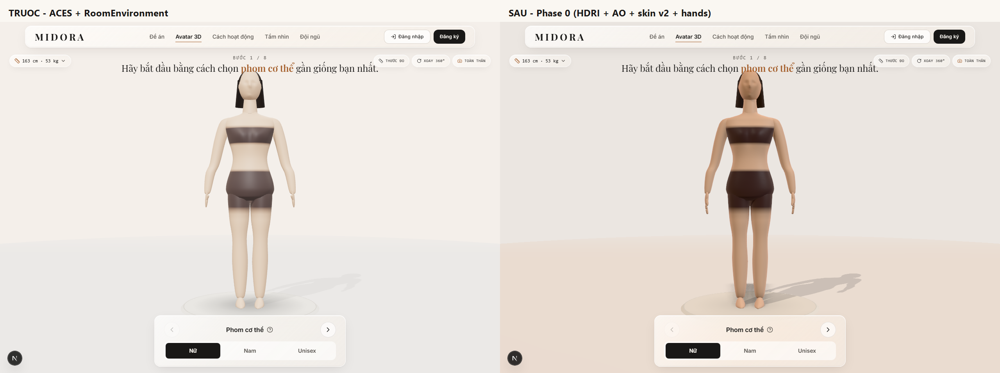
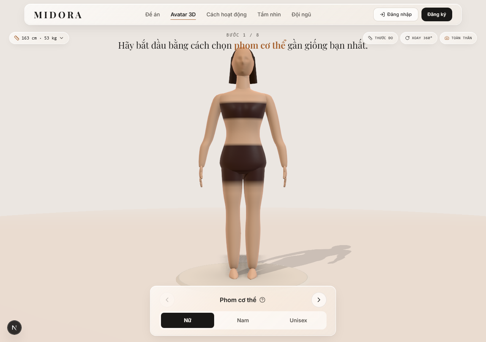

# NGHIÊN CỨU: NÂNG ĐỘ CHÂN THỰC & CHI TIẾT CHO MODEL CƠ THỂ NGƯỜI 3D

- **Dự án**: MIDORA – Digital Atelier for Vintage & Secondhand Fashion
- **Phạm vi**: module avatar 3D (`src/features/avatar/`), pipeline asset Blender/MPFB2, cách render trong `Avatar3DCanvas`
- **Câu hỏi nghiên cứu**: *Có cách nào để cấu trúc cơ thể người 3D trông giống thật hơn và nhìn chi tiết hơn không?*
- **Trạng thái**: báo cáo nghiên cứu – **chưa thay đổi code**. Mọi vị trí file/line đều là hiện trạng tại thời điểm viết.
- **Ngày**: 2026-11-11

---

## 0. TL;DR – 5 kết luận

1. **Nút thắt lớn nhất không phải shader, mà là hình học.** Rig hiện tại là `OrganicMannequinRig` dựng bằng lofting thủ tục: không có ngón tay, không có ngón chân, không có mắt/mí/lông mày, tai chỉ là một gờ nổi trên cầu. Ở khoảng cách camera 3.55 m, mỗi pixel tương đương **~2.7 mm**, nên mọi chi tiết nhỏ hơn 2–3 mm *buộc phải* nằm trong **normal map**, không thể là hình học. Muốn "giống thật" phải tách đúng hai tầng: **hình học lớn đúng giải phẫu + bề mặt vi mô bằng texture**.
2. **Đường nâng cấp đã có sẵn nhưng đang bị tắt.** Repo đã có pipeline MPFB2 (MakeHuman, CC0) → GLB + 10 morph target + skeleton, loader Meshopt/DRACO/KTX2 và `GlbMorphAvatarRig`, nhưng `public/models/avatar-manifest.json` đang `"enabled": false` → app chỉ chạy rig thủ tục.
3. **Chất liệu da hiện tại là "nhựa mịn", không phải da.** Bump map 128 px lặp 8×8 chỉ là nhiễu xám, thiếu albedo biến thiên (đỏ ở khớp, tím ở quầng mắt, vành môi), thiếu AO/cavity, thiếu SSS, tone mapping ACES làm highlight hơi "kim loại". Đây là nhóm thay đổi **rẻ nhất, hiệu quả rõ nhất** (2–3 ngày).
4. **Nghịch lý cần quyết định sớm:** quần áo hiện được *sơn* bằng vertex color lên thân trần (`paintBaseSurfaceColors`), không phải mesh vải thật. Cơ thể càng chân thực thì "áo sơn" càng lộ giả. Vì vậy lộ trình đúng là: **shading/ánh sáng → body GLB thật → trang phục là mesh thật + cloth/morph**. Đừng làm da photoreal trước khi có áo thật.
5. **Khuyến nghị mục tiêu "premium stylized realism" (M2), không phải photoreal tuyệt đối.** Với web 60 fps trên mobile, mục tiêu hợp lý là: silhouette + giải phẫu đúng, da có vi mô và SSS gần đúng, tóc/áo có vật liệu riêng, chuyển động sống. Photoreal thật (scan, Gaussian, MetaHuman) chỉ nên dùng cho ảnh hero/preview, không cho canvas tương tác.

### Bảng ưu tiên hành động

| # | Việc | Tác động | Công sức | Làm ngay? |
|---|------|----------|----------|-----------|
| 1 | Tone mapping filmic + HDRI studio + GTAO/SMAA | Cao | 0.5–1 ngày | ✅ |
| 2 | Skin material v2 + detail normal + warm rim (SSS giả) | Cao | 1–2 ngày | ✅ |
| 3 | Bật GLB MPFB2 + bake normal/AO + mắt + tóc card | Rất cao | 1.5–2 tuần | ✅ sau (1)(2) |
| 4 | Morph mở rộng (PCA từ target MPFB2) + blink/idle | Cao | 1 tuần | Sau (3) |
| 5 | Trang phục mesh thật + cloth/morph transfer | Rất cao | 3–6 tuần | Song song (4) |
| 6 | Server bake avatar theo số đo (cache GLB) | Cao (scale) | 3–4 tuần | Sau (5) |
| 7 | Gaussian splat / MetaHuman cho hero shot | Trung bình | 2–4 tuần | Không ưu tiên |

---

## 1. Hiện trạng: điều gì đang giới hạn độ thật?

### 1.1. Hai nhánh render

```text
Avatar3DCanvas
 ├── OrganicMannequinRig  (luôn dựng ngay, fallback)
 └── nếu manifest.enabled === true → GLTFLoader → GlbMorphAvatarRig
```

- `midora-frontend/src/features/avatar/components/Avatar3DCanvas.tsx:262-266` – dựng `OrganicMannequinRig` ngay lập tức.
- `Avatar3DCanvas.tsx:268-299` – chỉ tải GLB khi `manifest.enabled === true`.
- `midora-frontend/public/models/avatar-manifest.json` – `"enabled": false`, ghi chú "Set enabled=true after generating ...".
- `midora-frontend/scripts/mpfb2_generate_midora_avatar.py` – script sinh GLB, đã có morph + skeleton + đo chu vi.

**Kết luận 1.1:** sản phẩm đang chạy 100% hình học thủ tục. Nhánh GLB là "đường cao tốc" đã trải nhựa nhưng chưa mở.

### 1.2. Chẩn đoán chi tiết theo từng tầng

| Tầng | Hiện trạng (bằng chứng) | Hệ quả thị giác |
|------|--------------------------|-----------------|
| **Silhouette / giải phẫu** | Torso loft 56×56 ring (`OrganicMannequinBuilder.ts:18-19`), ~6.3k tri; tay/chân loft 26×24; đầu là sphere 48×36 biến dạng giải tích (`:155-243`); bàn tay chỉ có **khối bầu + ngón cái** (`:282-311`); bàn chân là ellipsoid kéo dài (`:245-280`); **không có mắt, mí, lông mày, môi tách khối, ngón tay** | Nhìn "mannequin nhựa": thiếu chi tiết 1–3 cm ở tay/chân/mặt – đúng vùng mắt người nhạy nhất |
| **Vi mô bề mặt** | `createMicroSkinTexture()` 128 px, nhiễu xám, repeat 8×8, dùng làm `bumpMap` scale 0.001 (`:132-153`, `:375-386`) | Da phẳng, lặp texture thấy rõ khi zoom; không có lỗ chân lông, nếp gấp, vân da |
| **Albedo** | Một `color` phẳng cho toàn bộ da (`update()` `:562-565`), chỉ nhân 0.97 cho joint | Không có đỏ ửng đầu gối/khuỷu tay, quầng mắt, vành môi, mạch máu → "da nhựa" |
| **Shading** | `MeshPhysicalMaterial` sheen 0.26, roughness 0.52, **không SSS**, không `specularIntensity`/`clearcoat` theo vùng | Vùng chuyển sáng–tối bị "cắt" cứng, thiếu ánh đỏ ấm xuyên da, highlight đều đều |
| **Tone mapping** | `ACESFilmicToneMapping`, exposure 1.06 (`Avatar3DCanvas.tsx:151-152`) | ACES nén highlight theo hướng lệch hue/desaturate → da hơi "kim loại", mất sắc hồng |
| **Ánh sáng** | `RoomEnvironment` IBL cường độ **0.44** (`:176-182`) + hemi 0.55 + 3 directional; shadow PCF 1024 (`:188-201`) | IBL yếu → form bẹt, thiếu micro-contrast; bóng đổ thô; không có AO màn hình |
| **Tóc** | Sphere cap + cylinder hở (`:483-546`), `MeshStandardMaterial` roughness 0.74 | Tóc như mũ bảo hiểm, không sợi, không anisotropic |
| **Chuyển động** | Chỉ breathing (pivot scale nhẹ) | Không blink, không dồn trọng tâm, không cử động ngón → "tượng" |
| **Trang phục** | Sơn vertex color `STUDIO_APPAREL_COLOR` lên torso (`:817-850`) | Không có nếp gấp vải, không silhouette áo → mâu thuẫn với body realistic |

### 1.3. "Trần chân thực" của phương pháp lofting thủ tục

Lofting là cách tốt để giữ **đúng số đo** (chu vi → bán kính) và cập nhật 60 fps, nhưng nó có trần:

- Mỗi ring là một ellipse biến dạng → không thể tạo **nếp gấp da, nếp gấp cơ, xương lồi** có hình dạng phức tạp.
- Không có topology loop quanh mắt/miệng/khớp → không thể rig mặt, không thể morph biểu cảm.
- Chi tiết giải phẫu (xương đòn, mỏm trên ổ chảo, mắt cá, gân Achilles) đòi hỏi **displacement theo vùng**, mà lofting chỉ cho displacement theo (góc, chiều cao) → thiếu "điêu khắc".

→ Lofting nên giữ vai trò **bộ xương số đo** (điều khiển tỉ lệ, chu vi, landmark), còn **bề mặt** nên đến từ base mesh giải phẫu + morph target.

---

## 2. Độ thật đến từ đâu: 6 tầng tín hiệu

| Tầng | Kích thước đặc trưng | Công cụ | Ghi chú cho MIDORA |
|------|----------------------|---------|--------------------|
| 1. Silhouette & tỉ lệ | 1–10 cm | Hình học + số đo | Quyết định 60–70% cảm nhận "người thật" ở khoảng cách toàn thân |
| 2. Giải phẫu bề mặt | 5–30 mm | Sculpt / normal map tần số thấp | Xương đòn, xương bả vai, gân, cơ |
| 3. Vi mô da | 0.05–2 mm | Normal map + roughness | Không thể là hình học ở 2.7 mm/px |
| 4. Albedo & sắc tố | 1–50 mm | Texture / vertex color thông minh | Đỏ khớp, quầng mắt, môi, mạch, tàn nhang |
| 5. Quang học da | — | SSS, dual specular, sheen | Yếu tố "da thịt" vs "nhựa" |
| 6. Ánh sáng & hậu kỳ | — | HDRI, AgX, GTAO, DOF | Khuếch đại hoặc phá huỷ 5 tầng trên |

### Ngân sách pixel (rất quan trọng để phân bổ công sức)

Camera mặc định `full`: position z ≈ 3.55 × (H/1.63), FOV dọc 38° (`Avatar3DCanvas.tsx:38-65`).

- Ở H = 1.63 m: khoảng cách 3.55 m → khung hình cao `2 × 3.55 × tan(19°) ≈ 2.44 m`.
- Canvas cao 900 px → **≈ 2.7 mm/px**.
- Preset `upper` (z ≈ 2.05 m) → khung cao ≈ 1.41 m → **≈ 1.6 mm/px**.

Hệ quả:

- Chi tiết < 1.5 mm (lỗ chân lông, nếp da) **chỉ có thể là normal map** – đừng cố thêm hình học.
- Chi tiết 1–3 mm (khớp ngón, móng, môi) cần **normal map tần số trung + hình học thô đúng**.
- Chi tiết > 5 mm (xương đòn, đầu gối, mắt cá) **phải là hình học** – nếu không, silhouette sai và mắt người phát hiện ngay.
- Ở chế độ zoom cận (nếu sau này có), cần LOD + texture 4K; hiện tại 2K là đủ.

---

## 3. Sáu hướng tiếp cận – so sánh

| Hướng | Độ chân thực | Chi tiết | Công sức | License | 60 fps mobile | Rủi ro | Khi nào dùng |
|-------|--------------|----------|----------|---------|----------------|--------|--------------|
| **A. Nâng cấp rig thủ tục tại chỗ** (shading, normal map, thêm mắt/ngón tay bằng primitive) | 4–5/10 | Trung bình | 3–7 ngày | Code nội bộ | Tốt | "Uncanny nửa vời" nếu thêm mặt dở | Ngay – quick win |
| **B. MPFB2/MakeHuman → GLB + morph** (đã có scaffold) | 6–7/10 | Khá | 1.5–2 tuần | Asset CC0 (bán được) | Tốt (meshopt) | Base mesh "game 2010", cần bake thêm | Tuần này |
| **C. Base mesh CC0 + sculpt + bake + morph** (Blender Studio Human Base Meshes) | 7.5–8.5/10 | Cao | 3–6 tuần (có artist) | CC0 | Tốt nếu LOD + KTX2 | Cần kỹ năng sculpt/bake | Quý này |
| **D. Scan người thật (photogrammetry/dịch vụ)** | 9/10 | Rất cao | 4–8 tuần + chi phí | Cần model release + hợp đồng | Nặng, phải decimate/bake | Pháp lý dữ liệu sinh trắc | Khi cần hero asset |
| **E. Body model tham số từ số đo** (SMPL-X, ANSUR II + PCA) | 6.5–8/10 (hình thể) | Trung bình | 2–4 tuần | **SMPL-X: phi thương mại**, cần license Meshcapade | Tốt nếu pre-bake | License + tích hợp | Nâng cấp "đúng số đo" |
| **F. Neural/Gaussian avatar** (GaussianAvatars, Spark) | 9.5/10 | Rất cao | 1–3 tháng | Phức tạp, phụ thuộc nghiên cứu | Kém trên mobile | Không có topology để mặc đồ | Hero shot, về sau |
| **G. MetaHuman** (Epic) | 9/10 | Rất cao | 2–4 tuần | Miễn phí < 1 triệu USD doanh thu, dùng được với engine khác | Nặng (~100k+ tri) | Pipeline Unreal, web hoá phức tạp | Desktop/hero |

> **Đọc bảng này thế nào:** cột "Độ chân thực" là mức tối đa đạt được *nếu làm đúng*. Với MIDORA, **B + C** là con đường chính; **E** là phần "não" để hình thể khớp số đo; **F/G** chỉ để làm ảnh marketing.

### 3.1. Vì sao B (MPFB2) là bước nhảy lớn nhất với chi phí thấp nhất

- MakeHuman có base mesh giải phẫu đầy đủ: 5 ngón tay có khớp, ngón chân, vành tai, mắt (tuỳ chọn), topology loop chuẩn.
- Hệ target của MakeHuman gồm hàng trăm target (macrodetails, muscle, age, gender, proportions...) → có thể tổ hợp thành **không gian hình thể** thay vì 10 shape key thủ công.
- Asset CC0: được phép bán sản phẩm tạo ra, không cần trả phí ([MakeHuman FAQ](http://makehumancommunity.org/wiki/index.php?title=FAQ:Can_I_sell_models_created_with_MakeHuman%3F)).
- Repo đã có loader + calibration + morph solver → chi phí tích hợp thấp.

### 3.2. Vì sao C (base mesh CC0 Blender Studio) đáng làm sau B

Bộ **Human Base Meshes** của Blender Studio (Blender 3.6+, CC0) gồm 17 mesh: nam/nữ photoreal + stylized, cùng các bộ phận rời (đầu, hàm, bàn tay, bàn chân, nhãn cầu), quad topology sạch, có UV, có multi-resolution detail ([CG Channel](https://www.cgchannel.com/2023/06/download-blender-studios-free-human-base-meshes/)). Đây là "nguyên liệu" tốt hơn MakeHuman để sculpt chi tiết và bake, nhưng cần artist + thời gian.

---

## 4. Lộ trình 3 pha (+ quick wins)

### Pha 0 – "Shading & ánh sáng" (2–3 ngày, không đổi hình học)

Mục tiêu: nâng cảm giác premium ngay, không rủi ro topology.

1. Đổi tone mapping sang **Neutral** (hoặc AgX) và **bù exposure** để giữ màu nền thương hiệu (xem §14 — bài học thực nghiệm: AgX + composer làm nền canvas lệch xám rõ rệt).
2. Thay `RoomEnvironment` bằng **HDRI studio CC0** (Poly Haven) qua `PMREMGenerator`, `environmentIntensity` 0.5–0.9.
3. Thêm chuỗi hậu kỳ **GTAO + SMAA + OutputPass**.
4. **Skin material v2**: `normalMap` (detail), `roughnessMap`, `aoMap`, `specularIntensity` ~0.5, `sheen` 0.3, `clearcoat` 0.06.
5. **Detail normal map** 512 px (thủ tục hoặc mua) lặp 6–10×, thêm lớp tần số thấp cho nếp gấp.
6. **Warm rim (SSS giả)** ở góc nhìn grazing.
7. Tóc: `MeshPhysicalMaterial` + `anisotropy`, hoặc card alpha-test.
8. Tăng chất lượng bóng: `PCFSoftShadowMap` + `shadow.radius`, hoặc contact shadow mềm hơn.

Kỳ vọng: +1.5–2 điểm "chân thực" theo thang 10, **không tăng polycount**, chi phí GPU thêm ~1–2 ms.

### Pha 1 – "Hình học & bề mặt" (1.5–2 tuần)

1. Bật `manifest.enabled = true`, dùng GLB MPFB2 (nữ + nam + neutral).
2. Bake từ high-poly: **normal (tangent), AO, curvature/cavity, thickness**.
3. PBR maps: albedo (có sắc tố), roughness, specular; KTX2 2K (albedo/normal) + 1K (packed).
4. Thêm **mắt** (nhãn cầu + iris + cornea) *hoặc* chọn hướng "faceless mannequin" (xem §5.1).
5. Tóc **hair card** alpha-test + anisotropic; lông mày/mi bằng card mảnh.
6. Morph mở rộng: 10 cơ bản + 6–12 mode PCA (§6.4).
7. Blink + idle: blink morph hoặc eyelid rig; breathing đã có.
8. Nén: **Meshopt** (giữ morph) + **KTX2/Basis**; LOD 2 mức.

Kỳ vọng: 7/10; GLB 3–6 MB; 45–70k tri; 60 fps desktop, 30–45 fps mobile trung bình.

### Pha 2 – "Digital twin từ số đo" (3–4 tuần)

1. **Server-side bake**: Blender headless + MPFB2, nhận `body_profiles`, xuất GLB đã *áp đúng số đo*; cache theo hash số đo; CDN.
2. **Mô hình hình thể thống kê**: hồi quy số đo → hệ số hình dạng (PCA trên ANSUR II hoặc trên không gian target MPFB2) → hình thể đa dạng, không chỉ 5 preset.
3. **Trang phục thật**: garment mesh + morph transfer (may trên avatar neutral rồi transfer sang avatar người dùng), hoặc cloth sim offline theo từng size.
4. Đo đạc: so chu vi mesh với số đo nhập, sai số mục tiêu ≤ 1 cm.

### Pha 3 – "Hero photoreal" (tuỳ chọn)

- Gaussian splat head/hands (GaussianAvatars, render bằng Spark) cho ảnh marketing.
- Hoặc MetaHuman cho desktop showcase.
- Không dùng cho canvas tương tác chính.

---

## 5. Giải phẫu: checklist chi tiết cần có

Đây là danh sách để **sculpt/normal map** – không phải tất cả đều cần hình học; cột "nên làm bằng" quyết định điều đó.

### 5.1. Quyết định chiến lược cho khuôn mặt

Hiện tại đầu có mũi/môi nhưng **không có mắt** – đây là trạng thái tệ nhất (nửa người nửa tượng). Chọn một trong hai:

- **Faceless mannequin** (khuyến nghị cho try-on): đầu mượt, không mũi/miệng chi tiết, tập trung vào tóc và silhouette. Đây là ngôn ngữ thời trang hợp lệ, tránh uncanny valley, rẻ.
- **Full face**: mắt + mí + lông mày + môi tách khối + tai đầy đủ. Đắt và dễ rơi vào uncanny nếu làm dở.

### 5.2. Bảng landmark

| Vùng | Landmark | Độ nổi gợi ý | Nên làm bằng |
|------|----------|---------------|--------------|
| Đầu | Cung mày, ổ mắt, sống mũi, đầu mũi, cánh mũi | 4–20 mm | Hình học + normal |
| Đầu | Rãnh nhân trung, viền môi trên/dưới, rãnh mũi–má | 2–5 mm | Normal map |
| Đầu | Vành tai (helix), hố tai (concha), tragus | 4–18 mm | Hình học |
| Đầu | Nếp mí, quầng mắt, rãnh lệ | 2–5 mm | Normal map |
| Cổ | Cơ ức–đòn–chũm, hõm cổ (sternal notch) | 8–15 mm | Hình học |
| Thân | Xương đòn, đầu xương cùng vai, gai bả vai | 5–12 mm | Hình học |
| Thân | Cơ ngực, răng cưa, cơ thẳng bụng, rốn | 3–15 mm | Hình học + normal |
| Thân | Mào chậu, gai chậu trước trên, nếp bẹn | 5–12 mm | Hình học |
| Thân | Rãnh cột sống, cơ dựng gai, hõm cùng | 5–15 mm | Hình học |
| Tay | Cơ delta, cơ nhị đầu, hố trước khuỷu | 8–25 mm | Hình học |
| Tay | Mỏm trụ/mỏm quay, gân cổ tay | 3–8 mm | Normal |
| Tay | Khớp bàn–ngón (MCP), đốt (PIP/DIP), móng | 3–10 mm | Hình học + normal |
| Tay | Nếp gan bàn tay, gò ngón cái | 2–10 mm | Normal |
| Chân | Cơ tứ đầu, xương bánh chè, lồi củ chày | 6–25 mm | Hình học |
| Chân | Cơ sinh đôi, gân Achilles, mắt cá trong/ngoài | 8–30 mm | Hình học |
| Chân | Cung gan bàn chân, các ngón, móng | 3–15 mm | Hình học |

> Đây là **gợi ý tỉ lệ để sculpt**, không phải số đo y khoa tuyệt đối. Mục tiêu là silhouette và bóng đổ đúng, không phải giải phẫu học.

### 5.3. Topology loop tối thiểu (nếu tự dựng/retopo)

- Mắt: 8–16 edge loop quanh hốc mắt; 2–3 loop cho mí.
- Miệng: 12–16 loop quanh môi.
- Mũi: 8 loop quanh cánh mũi.
- Tai: 8–12 ring.
- Khớp ngón: 4–6 loop mỗi khớp.
- Khuỷu/gối/vai: 3–5 loop để biến dạng không bị "gãy".

### 5.4. Bất đối xứng

Cơ thể thật bất đối xứng 1–3%. Thêm lệch nhẹ (vai, ngực, đầu gối) làm tăng cảm giác thật; nhưng nếu mục tiêu là **đo số đo**, giữ đối xứng để vòng đo chính xác.

---

## 6. Pipeline sản xuất asset (Blender)

### 6.1. Chọn base mesh

| Nguồn | License | Ưu | Nhược |
|-------|---------|----|-------|
| MakeHuman / MPFB2 | Asset CC0 (bán được) | Giàu target, có rig game_engine, có sẵn script | Base mesh kiểu game cũ, cần bake thêm |
| Blender Studio Human Base Meshes | CC0 | Quad sạch, multi-res, có bộ phận rời (mắt, tay, chân) | Cần sculpt/rig/bake từ đầu |
| MetaHuman | Epic license (miễn phí < 1M USD) | Đẹp nhất, có rig mặt | Nặng, pipeline Unreal |
| Scan thương mại | Trả phí | Chân thực nhất | Giá + license + decimate |

### 6.2. Các bước

```text
1. Base mesh (CC0) → kiểm tra scale thật (1 unit = 1 m, Y-up khi export)
2. Retopo + UV (single 4K hoặc UDIM → gộp 1 set 2K khi export web)
3. Multires 3–5 cấp → sculpt giải phẫu (bảng §5.2)
4. Sculpt vi mô: lỗ chân lông, nếp gấp, vân da (alpha brush)
5. Bake: normal (tangent), AO, curvature, thickness (cho SSS)
6. Texture PBR: albedo (base + sắc tố), roughness, specular/intensity
7. Morph target: 10 cơ bản + PCA modes (§6.4)
8. Rig: skeleton + skin weight; A-pose; bone ngón tay
9. Export GLB: +Y up, morph + morph normal, skin, material
10. Nén: gltf-transform meshopt (giữ morph) + KTX2 (Basis)
11. Sinh manifest: neutral measurements + calibration ranges
```

### 6.3. Những lỗi pipeline hay gặp

- **Draco + morph target**: Draco không nén morph target → dùng **Meshopt** (repo đã có `MeshoptDecoder`).
- **Normal map không tangent**: bake sai tangent → normal map "gợn"; kiểm tra trong three bằng `normalScale` âm nếu cần.
- **UV seam ở mặt/ngực**: seam rơi vào vùng nhìn thấy → chọn seam dưới tóc, sau tai, dọc hông.
- **Morph làm hỏng normal**: bật `export_morph_normal=True` (đã có) nhưng phải kiểm tra morph nào làm lệch normals.
- **Scale**: MakeHuman mặc định 1 unit = 1 dm ở một số bản → kiểm tra `neutralHeightCm` khớp bounding box.

### 6.4. Morph mở rộng bằng PCA (kỹ thuật đáng chú ý)

Vấn đề: 10 shape key thủ công không đủ để mô tả hình thể đa dạng; muốn 40 key thì file phình và morph nặng.

Cách làm:

1. Trong Blender, chạy MPFB2 với **hàng nghìn tổ hợp target ngẫu nhiên** (macrodetails, muscle, weight, proportions, age...).
2. Sample vertex positions → ma trận `N × 3V`.
3. PCA → lấy 12–16 eigen-shape đầu (chiếm phần lớn phương sai).
4. Xuất các eigen-shape thành morph target, kèm ma trận hồi quy **số đo (chest/waist/hips/shoulder/weight) → hệ số PCA**.
5. Runtime: giải hệ số từ số đo người dùng (như `solveGlbBodyControls` hiện tại) → áp morph influence.

Lợi ích: hình thể **thống kê thật** thay vì 5 preset; số morph vẫn nhỏ; three.js r187 pack morph vào `DataArrayTexture` nên nhiều target vẫn render được.

Lưu ý bộ nhớ: `morphTargets × vertices × 3 float`. Ví dụ 60k vertex × 16 morph × 12 byte ≈ **11.5 MB** – chấp nhận được, nhưng phải tính vào ngân sách.

---

## 7. Recipe code cho repo (three r187)

Các snippet dưới đây viết theo API đã kiểm tra trong `node_modules/three@0.187`.

### 7.1. Renderer: tone mapping + HDRI studio

```ts
// Avatar3DCanvas.tsx – thay khối tone mapping + RoomEnvironment
renderer.toneMapping = THREE.NeutralToneMapping; // hoặc AgXToneMapping
renderer.toneMappingExposure = 1.45;             // bù cho việc nền bị tone-map

const pmrem = new THREE.PMREMGenerator(renderer);
const hdr = await new HDRLoader().loadAsync("/env/studio_small_09_1k.hdr"); // Poly Haven CC0
hdr.mapping = THREE.EquirectangularReflectionMapping;
scene.environment = pmrem.fromEquirectangular(hdr).texture;
scene.environmentIntensity = 0.5;              // giảm đèn khi tăng exposure
hdr.dispose();
pmrem.dispose();
```

Ghi chú:

- three r187 **deprecated `RGBELoader`** → dùng `HDRLoader`; `PCFSoftShadowMap` đã bị xoá → dùng `PCFShadowMap` + `shadow.radius`.
- Khi dùng `EffectComposer` + `OutputPass`, **màu `scene.background` cũng bị tone-map**. Nền `#F4EFEA` qua ACES/AgX bị đổi thành xám `#C4C2C1`; Neutral + exposure 1.45 + đèn giảm ~30% cho ra `#EBE6E1` (gần như khớp trang). Nếu cần khớp tuyệt đối: render nền trong suốt (alpha) và để CSS lo nền — xem §14.
- Nếu không muốn thêm asset HDR: giữ `RoomEnvironment` nhưng nâng `environmentIntensity` lên 0.8–1.0 và thêm `LightProbe`/`PMREM` từ gradient studio tự dựng.

### 7.2. Hậu kỳ: GTAO + SMAA + OutputPass

```ts
import { EffectComposer } from "three/addons/postprocessing/EffectComposer.js";
import { RenderPass } from "three/addons/postprocessing/RenderPass.js";
import { GTAOPass } from "three/addons/postprocessing/GTAOPass.js";
import { SMAAPass } from "three/addons/postprocessing/SMAAPass.js";
import { OutputPass } from "three/addons/postprocessing/OutputPass.js";

const composer = new EffectComposer(renderer);
composer.addPass(new RenderPass(scene, camera));

const gtao = new GTAOPass(scene, camera, width, height);
gtao.updateGtaoMaterial({ radius: 0.22, distanceExponent: 1.2, thickness: 0.9, scale: 1.0, samples: 16 });
gtao.updatePdMaterial({ lumaPhi: 10, depthPhi: 2, normalPhi: 3, radius: 4, radiusExponent: 1, samples: 16 });
gtao.blendIntensity = 0.85;
composer.addPass(gtao);

composer.addPass(new SMAAPass());
composer.addPass(new OutputPass()); // áp tone mapping + chuyển sang sRGB

// trong animation loop: composer.render() thay renderer.render(scene, camera)
// khi resize: composer.setSize(w, h); composer.setPixelRatio(Math.min(dpr, 2));
```

Lưu ý:

- `OutputPass` chịu trách nhiệm tone mapping + color space; **không** gọi `renderer.render` song song.
- GTAO cần depth + normal; với `Scene` có nhiều mesh nhỏ (tay, tóc), tăng `thickness` để tránh halo.
- Trên mobile yếu: thay GTAO bằng SSAO nhẹ hơn, hoặc bake AO vào texture (rẻ nhất).

### 7.3. Skin material v2

```ts
const skin = new THREE.MeshPhysicalMaterial({
  color: 0xdfb99b,                 // nhân với albedo map
  map: albedoMap,                  // KTX2 2K, colorSpace = SRGBColorSpace
  normalMap: detailNormal,         // normal map vi mô
  normalScale: new THREE.Vector2(0.6, 0.6),
  roughnessMap: roughMap,
  roughness: 0.48,
  metalness: 0.0,
  sheen: 0.3,                      // lông tơ / tán xạ lớp trên
  sheenRoughness: 0.7,
  sheenColor: new THREE.Color("#ffd9c9"),
  clearcoat: 0.06,                 // da hơi dầu ở vùng chữ T
  clearcoatRoughness: 0.4,
  specularIntensity: 0.5,          // F0 ~0.02 (da khô); 0.6–0.7 nếu da dầu
  ior: 1.4,
  aoMap: aoMap,                    // three r152+ lấy theo texture.channel (mặc định 0 = uv)
});
skin.normalMap!.wrapS = skin.normalMap!.wrapT = THREE.RepeatWrapping;
skin.normalMap!.repeat.set(7, 7);
```

Quan trọng: **tách vật liệu theo vùng** (mặt, tay, thân, chân) để mỗi vùng có repeat/roughness riêng; dùng chung một `normalMap` nhưng khác `repeat` yêu cầu material riêng (hoặc dùng `onBeforeCompile` để nhân UV).

### 7.4. Sinh detail normal map thủ tục (fallback khi chưa có texture mua)

```ts
function createPoreNormal(size = 512): THREE.DataTexture {
  const height = new Float32Array(size * size);
  const hash = (x: number, y: number) => {
    const n = Math.sin(x * 127.1 + y * 311.7) * 43758.5453;
    return n - Math.floor(n);
  };
  const period = 32;
  const noise = (x: number, y: number) => {
    const xi = Math.floor(x), yi = Math.floor(y);
    const xf = x - xi, yf = y - yi;
    const u = xf * xf * (3 - 2 * xf), v = yf * yf * (3 - 2 * yf);
    const p = (i: number, j: number) =>
      hash(((i % period) + period) % period, ((j % period) + period) % period);
    return THREE.MathUtils.lerp(
      THREE.MathUtils.lerp(p(xi, yi), p(xi + 1, yi), u),
      THREE.MathUtils.lerp(p(xi, yi + 1), p(xi + 1, yi + 1), u),
      v
    );
  };

  for (let y = 0; y < size; y++) {
    for (let x = 0; x < size; x++) {
      const u = (x / size) * period, v = (y / size) * period;
      let h = noise(u, v) * 0.55;
      h += noise(u * 3, v * 3) * 0.28;
      h += noise(u * 9, v * 9) * 0.12;
      height[y * size + x] = h;
    }
  }

  const data = new Uint8Array(size * size * 4);
  const at = (x: number, y: number) =>
    height[((y + size) % size) * size + ((x + size) % size)];
  for (let y = 0; y < size; y++) {
    for (let x = 0; x < size; x++) {
      const dx = (at(x + 1, y) - at(x - 1, y)) * 4;
      const dy = (at(x, y + 1) - at(x, y - 1)) * 4;
      const n = new THREE.Vector3(-dx, -dy, 1).normalize();
      const i = (y * size + x) * 4;
      data[i] = (n.x * 0.5 + 0.5) * 255;
      data[i + 1] = (n.y * 0.5 + 0.5) * 255;
      data[i + 2] = (n.z * 0.5 + 0.5) * 255;
      data[i + 3] = 255;
    }
  }

  const tex = new THREE.DataTexture(data, size, size, THREE.RGBAFormat);
  tex.wrapS = tex.wrapT = THREE.RepeatWrapping;
  tex.colorSpace = THREE.NoColorSpace;
  tex.needsUpdate = true;
  return tex;
}
```

Đây chỉ là **fallback**. Normal map da thật (scan) tốt hơn nhiều; nếu có ngân sách, mua gói skin detail (Texturing.xyz, 3D Scan Store) hoặc scan tay.

### 7.5. SSS giả: warm rim (an toàn, drop-in)

```ts
mat.onBeforeCompile = (shader) => {
  shader.fragmentShader = shader.fragmentShader.replace(
    "#include <opaque_fragment>",
    /* glsl */ `
      float sssRim = pow(1.0 - saturate(dot(normalize(normal), normalize(vViewPosition))), 2.2);
      outgoingLight += diffuseColor.rgb * vec3(0.11, 0.030, 0.012) * sssRim;
      #include <opaque_fragment>
    `
  );
};
mat.customProgramCacheKey = () => "skin-sss-rim";
```

Đây là xấp xỉ "da mỏng ở rìa" – hiệu quả rõ ở tai, mũi, ngón tay. **Không** phải SSS vật lý.

### 7.6. SSS đúng: pre-integrated skin shading (Penner & Borshukov)

- Ý tưởng: precompute LUT 3 chiều theo `N·L`, `N·V`, độ cong (curvature) → tra cứu diffuse đã tán xạ, thay vì `N·L` cứng.
- Trong three.js: inject vào `onBeforeCompile`, thay diffuse term; cần **curvature map** bake từ Blender (hoặc xấp xỉ bằng `1 - AO`).
- Chi phí: 1 texture 3D (hoặc 2D LUT) + shader patch; không nặng.
- Đây là hướng "đúng" nếu muốn da đạt 8/10; nhưng phức tạp hơn warm rim nhiều.

### 7.7. Mắt (nếu chọn full face)

- Nhãn cầu: sphere 32×24, `MeshPhysicalMaterial` clearcoat 1.0, roughness 0.05.
- Iris: texture radial (mống mắt + limbal ring tối), đặt trên mặt phẳng trước nhãn cầu hoặc dùng decal.
- Giác mạc: sphere trong suốt hơi lồi, `transmission` — **cẩn thận**: transmission gây render 2 lần, tốn; với mắt nhỏ thì chấp nhận được.
- Mi: card mảnh hoặc mesh cong; blink bằng morph (2 shape: mở/nhắm) hoặc bone.

### 7.8. Tóc: card + anisotropy

```ts
const hair = new THREE.MeshPhysicalMaterial({
  color: 0x2a1f1a,
  map: hairAlphaColor,          // RGBA, alpha = sợi
  alphaTest: 0.45,
  transparent: false,           // alphaTest để depth đúng
  side: THREE.DoubleSide,
  roughness: 0.35,
  metalness: 0.0,
  anisotropy: 0.85,             // three r163+
  anisotropyRotation: Math.PI / 2,
  sheen: 0.4,
  sheenColor: new THREE.Color("#8a6a52"),
});
```

Card cần **sort theo depth** hoặc dùng `alphaHash` để tránh viền răng cưa.

### 7.9. Trang phục (điểm nghẽn thật sự)

Hiện tại áo là vertex color. Để body realistic không bị "lệch pha":

- Garment mesh riêng, skinned cùng skeleton body, hoặc morph transfer từ body neutral.
- May trên avatar neutral → transfer weight/morph sang avatar người dùng (Blender: Data Transfer + Surface Deform).
- Nếu chưa làm cloth: dùng **morph trang phục** cho 3–5 dáng người chính, chấp nhận xấp xỉ.
- Cloth sim offline (Blender/Marvelous) → bake thành animation/morph cho các tư thế chuẩn.

---

## 8. Ngân sách hiệu năng

| Hạng mục | Desktop | Mobile tầm trung | Ghi chú |
|----------|---------|------------------|---------|
| Triangle body | 50–80k | 20–35k (LOD1) | Dưới 15k như hiện tại là quá thấp cho chi tiết 1 cm |
| Texture | albedo/normal 2K, packed 1K | 1K/1K | KTX2 (ETC1S hoặc UASTC) |
| GLB | 4–8 MB | 3–5 MB | Meshopt + KTX2 |
| Draw calls | < 30 | < 20 | Gộp material, atlas |
| Morph targets | 12–20 | 8–12 | three pack vào DataArrayTexture |
| Shadow map | 2048 | 1024–1536 | PCFSoft |
| Hậu kỳ | GTAO + SMAA | SSAO nhẹ hoặc không | GTAO ~1–2 ms desktop |
| FPS mục tiêu | 60 | 30–60 | Đo trên iPhone 12 / Snapdragon 778G |

**Quy tắc:** mọi thứ thêm vào phải có đường lui (LOD, tắt hậu kỳ, giảm texture) cho máy yếu.

---

## 9. Đo lường chất lượng

| Chỉ số | Cách đo | Mục tiêu |
|--------|---------|----------|
| Sai số số đo | So chu vi mesh (bisect) với số đo nhập | ≤ 1 cm |
| Silhouette | IoU mặt trước/nghiêng với ảnh thật (nếu có) | ≥ 0.9 |
| Cảm nhận chân thực | A/B test 2AFC, 30–50 người | ≥ 70% chọn "giống người thật" cho M3; ≥ 60% "cao cấp" cho M2 |
| Hiệu năng | FPS trung bình 30 s, first render | 60 fps desktop, ≥ 30 fps mobile |
| Bộ nhớ GPU | `renderer.info.memory` | < 200 MB |
| Tải | Lighthouse/Network | GLB + texture < 2.5 s trên 4G |

---

## 10. Pháp lý & dữ liệu

| Tài nguyên | License | Dùng thương mại? |
|------------|---------|------------------|
| MakeHuman / MPFB2 assets | CC0 | ✅ (FAQ xác nhận được bán model tạo ra) |
| MPFB2 add-on code | GitHub ghi "Other" (xem `LICENSE.md` của repo) | Chỉ dùng như công cụ, không phân phối code |
| Blender Studio Human Base Meshes | CC0 | ✅ |
| MetaHuman | Epic license, miễn phí < 1M USD doanh thu, dùng được engine khác | ⚠️ đọc kỹ |
| SMPL / SMPL-X | Phi thương mại (nghiên cứu) | ❌ nếu không mua license Meshcapade |
| Poly Haven HDRI | CC0 | ✅ |
| Texturing.xyz / 3D Scan Store | Trả phí, điều khoản riêng | ⚠️ kiểm tra từng gói |
| Scan người thật | Cần model release + hợp đồng | ⚠️ |

**Dữ liệu cá nhân (Việt Nam):** số đo cơ thể + ảnh người dùng là dữ liệu cá nhân theo Nghị định 13/2023/NĐ-CP; nếu dùng ảnh để ước lượng hình thể thì cần consent rõ ràng, mục đích cụ thể, lưu trữ tối thiểu. Nếu có người dùng EU: GDPR (dữ liệu sinh trắc có thể là sensitive).

**Moderation:** avatar cơ thể cần quy tắc (không tạo hình thể lệch chuẩn dung tục, không dùng ảnh người khác khi chưa đồng ý), đặc biệt nếu sau này cho upload ảnh.

---

## 11. Rủi ro & cách giảm

| Rủi ro | Giảm thiểu |
|--------|------------|
| Uncanny valley khi thêm mặt nửa vời | Chọn faceless hoặc full face, không ở giữa |
| Body realistic nhưng áo "sơn" | Làm garment mesh trước/song song |
| GLB nặng, mobile tụt FPS | LOD + KTX2 + Meshopt + tắt hậu kỳ trên máy yếu |
| Morph làm sai số đo | Bake lại chu vi theo morph; test tự động 20 tổ hợp số đo |
| License SMPL-X | Không dùng nếu chưa mua; ưu tiên CC0 |
| Ảnh hưởng văn hoá/đa dạng | Bổ sung dáng người châu Á, chiều cao thấp, body diversity |
| Đầu tư sai thứ tự | Làm Pha 0 trước, đo KPI, rồi mới mua asset/artist |

---

## 12. Khuyến nghị cuối

1. **Làm ngay Pha 0** – 2–3 ngày, không rủi ro, nâng rõ cảm giác premium: AgX + HDRI + GTAO + skin v2 + tóc anisotropic.
2. **Bật GLB MPFB2 trong 1–2 tuần** – đây là bước nhảy hình học lớn nhất; repo đã có 80% hạ tầng.
3. **Quyết định "faceless hay full face"** trước khi đổ công vào đầu/mắt.
4. **Đừng làm da photoreal trước khi có áo thật** – nếu không, sản phẩm sẽ "body 8/10, áo 3/10".
5. **Đầu tư vào hình thể thống kê (PCA/ANSUR)** – đây là giá trị riêng của MIDORA (đúng số đo, đa dạng), không phải đua photoreal với MetaHuman.
6. **Hero asset tách khỏi runtime** – Gaussian/MetaHuman chỉ cho ảnh marketing, không cho canvas.

---

## 13. Ghi chú triển khai Pha 0 (2026-11-11)

Pha 0 đã được hiện thực thử trong repo và kiểm chứng bằng **Playwright + Chromium headless (SwiftShader)**: chụp ảnh trước/sau, đo màu nền bằng pixel sampling. Đây là ghi chú thực nghiệm — không thay thế việc đo FPS trên thiết bị thật.

### 13.1. File thay đổi

| File | Thay đổi |
|------|----------|
| `midora-frontend/src/features/avatar/three/skinShading.ts` *(mới)* | Sinh normal map vi mô 512 (pore + nếp gấp, tileable), roughness map, patch SSS warm-rim qua `onBeforeCompile` |
| `midora-frontend/src/features/avatar/three/studioEnvironment.ts` *(mới)* | `HDRLoader` + PMREM cho HDRI studio, fallback `RoomEnvironment` |
| `midora-frontend/public/env/studio_small_09_1k.hdr` *(mới)* | HDRI CC0 Poly Haven (1.6 MB) |
| `midora-frontend/src/features/avatar/three/OrganicMannequinBuilder.ts` | Skin material v2; tóc `MeshPhysicalMaterial`; vertex tint vùng mặt; **bàn tay 5 ngón merged geometry** |
| `midora-frontend/src/features/avatar/components/Avatar3DCanvas.tsx` | Tone mapping + exposure, HDRI, GTAO/SMAA/OutputPass, đèn & bóng mềm, resize/dispose composer |

### 13.2. Bài học thực nghiệm (quan trọng)

1. **`scene.background` bị tone-map khi đi qua `EffectComposer` + `OutputPass`.** Đo thực tế: nền `#F4EFEA` → `#C4C2C1` với ACES, `#DFDEDC` với Neutral ở exposure 1.0. Đây là lý do khung 3D bị "xám" so với trang.
   - Cách xử lý đã dùng: `NeutralToneMapping` + `toneMappingExposure = 1.45` + giảm đèn/IBL ~30% → nền `#EBE6E1`, gần khớp trang mà model vẫn giữ độ sáng.
   - Cách triệt để (nếu cần khớp 100%): renderer `alpha: true`, `setClearAlpha(0)`, bỏ `scene.background`, thay sàn bằng `ShadowMaterial` để CSS lộ qua — đánh đổi: mất "sàn studio" liền mạch.
2. **three r187 đã bỏ `PCFSoftShadowMap`** (tự fallback sang PCF kèm warning) → dùng `PCFShadowMap` + `keyLight.shadow.radius = 3`.
3. **`RGBELoader` đã deprecated** → dùng `three/addons/loaders/HDRLoader.js`.
4. **Normal map vi mô quá mạnh sẽ thành "vải"**: repeat 6× + `normalScale 0.55` cho cảm giác vân vải. Hạ còn **repeat 14× + normalScale 0.25** (và gần như tắt bump) thì đọc ra da.
5. **Bàn tay cũ chỉ có khối bầu + ngón cái**; thay bằng palm ~8×10 cm + 4 ngón × 2 đốt + đầu ngón + ngón cái, **merge thành 1 geometry** → 1 draw call/tay, không tăng draw call.
6. **Vertex tint vùng mặt** (blush, môi, hốc mắt, tai) rẻ và hiệu quả, nhưng nếu đậm quá sẽ thành "vết bầm" — giữ hệ số ≤ 0.07.

### 13.3. Kết quả đo (ảnh chụp 1280×900, camera toàn thân)

| Hạng mục | Trước | Sau |
|----------|-------|-----|
| Màu nền canvas (góc trên trái) | `#F4EFEA` | `#EBE6E1` |
| Bàn tay | 2 khối rời | 1 mesh: palm + 8 đốt ngón + 4 đầu ngón + ngón cái |
| Da | bump 128 px, không normal | normal 512 (repeat 14) + roughness map + rim SSS |
| Tóc | `MeshStandardMaterial` | `MeshPhysicalMaterial` (sheen + clearcoat) |
| Hậu kỳ | không | GTAO (≥1024 px) + SMAA + OutputPass |
| Draw call thêm | 0 | +0 (hands merged) |
| FPS | chưa đo trên máy thật | **cần đo** — SwiftShader không đại diện |



*Trái: trước (ACES + RoomEnvironment). Phải: sau (HDRI studio + GTAO/SMAA + skin v2 + bàn tay 5 ngón).*



*Toàn thân sau Phase 0 — chú ý bóng đổ mềm, da có vi mô, bàn tay có ngón.*

> **Đánh giá thẳng thắn:** thay đổi rõ nhất là **ánh sáng/bóng và bàn tay**; khuôn mặt vẫn là mannequin không mắt, và "áo" vẫn là vertex color. Muốn tăng "giống thật" một cách rõ rệt phải sang **Pha 1** (GLB MPFB2 + bake + garment mesh) — Phase 0 chỉ kéo chất lượng cảm nhận lên, không thay đổi bản chất hình học.

### 13.4. Việc còn lại (Pha 0 → Pha 1)

- Đo FPS thật trên iPhone 12 / Snapdragon 778G; nếu GTAO quá nặng, hạ `samples` hoặc tắt theo `deviceMemory`.
- Quyết định "faceless mannequin" hay full face trước khi thêm mắt.
- Bật GLB MPFB2 (`manifest.enabled = true`), bake normal/AO, hair card.
- Nếu giữ rig thủ tục: thêm ngón chân, vành tai, và chọn hướng xử lý nền trong suốt để khớp màu tuyệt đối.

## 14. Tài liệu tham khảo

- Penner, E. & Borshukov, G. – *Pre-Integrated Skin Shading*, GPU Pro 2: [Taylor & Francis](https://www.taylorfrancis.com/chapters/edit/10.1201/b11325-9/pre-integrated-skin-shading-eric-penner-george-borshukov)
- three.js `GTAOPass` docs: [GitHub](https://github.com/mrdoob/three.js/blob/601bc21631e24674aa68fe5875f98d631a41b551/docs/pages/GTAOPass.html.md)
- three.js tone mapping constants (`AgXToneMapping`): kiểm tra trực tiếp `three@0.187` `src/constants.js`
- Blender Studio Human Base Meshes (CC0): [CG Channel](https://www.cgchannel.com/2023/06/download-blender-studios-free-human-base-meshes/)
- MakeHuman/MPFB2: [GitHub](https://github.com/makehumancommunity/mpfb2) · [FAQ bán model](http://makehumancommunity.org/wiki/index.php?title=FAQ:Can_I_sell_models_created_with_MakeHuman%3F)
- MetaHuman license: [metahuman.com/license](https://www.metahuman.com/license)
- SMPL licensing FAQ: [MPI-IS PDF](https://files.is.tue.mpg.de/black/talks/SMPL-made-simple-FAQs.pdf)
- GaussianAvatars (CVPR 2024): [GitHub](https://github.com/shenhanqian/gaussianavatars)
- Spark – 3D Gaussian Splatting cho three.js: [GitHub](https://github.com/sparkjsdev/spark)
- Poly Haven (HDRI CC0): [polyhaven.com](https://polyhaven.com)
- glTF extensions cho da/vật liệu: `KHR_materials_specular`, `KHR_materials_sheen`, `KHR_materials_clearcoat`, `KHR_materials_volume`, `KHR_materials_anisotropy` (GLTFLoader r187 hỗ trợ sẵn)
